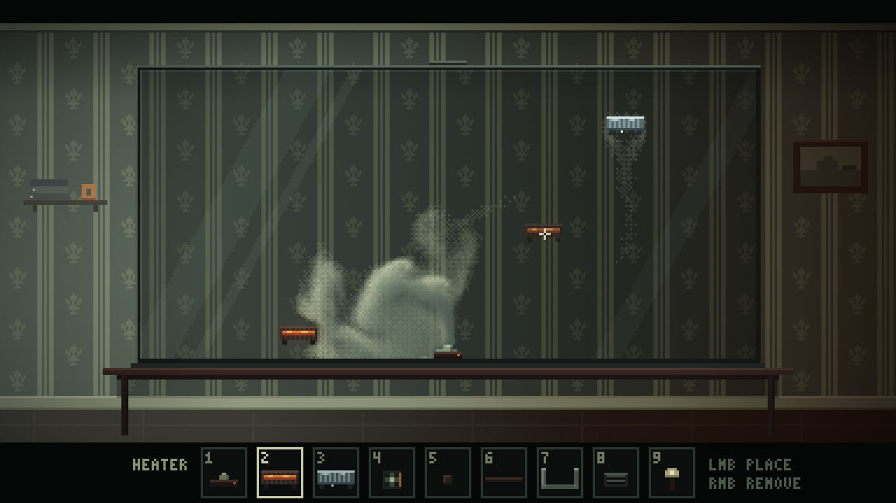

# MisTsiM

A glass box with a mist generator in it. You place things in the box and watch what the mist does.

Plain JavaScript and WebGL2, no build step and no dependencies.

## Run

Open `index.html` in a current Chrome, Firefox or Edge. It also works from any static host (GitHub Pages).

## Controls

| Input | Action |
| --- | --- |
| `1`–`9`, mouse wheel, or click a slot | pick a placeable |
| left click in the box | place it (blocks and shelves keep placing while you drag) |
| right click | remove what is under the cursor (drag to remove several) |
| `R` | turn the fan |
| touch | tap an empty spot to place, tap an item to remove |

## The bar

| # | Item | What it does |
| --- | --- | --- |
| 1 | Mister | emits cool mist with a small upward puff |
| 2 | Heater | hot surface: air rises, mist evaporates |
| 3 | Cooler | cold surface: air sinks, vapour condenses into fog, drops form |
| 4 | Fan | pushes air one way (`R` turns it); air passes through it |
| 5 | Block | solid 4x4 building block |
| 6 | Shelf | thin solid plank |
| 7 | Basin | open-topped container; heavy mist pools in it |
| 8 | Vent | removes mist and vapour around it |
| 9 | Lamp | lights the mist, slightly warm |

## Docs

- [docs/DESIGN.md](docs/DESIGN.md) — how the simulation and the picture work
- [docs/HANDOFF.md](docs/HANDOFF.md) — current state, how to add placeables, what to build next

## Windows exe

`launcher/build.sh` builds `launcher/MisTsiM.exe` (needs Go). The exe has the app embedded, serves it on a
local port and opens it in a borderless Edge or Chrome window, or the default browser if neither is found.
It exits on its own about 90 seconds after the window is closed.
